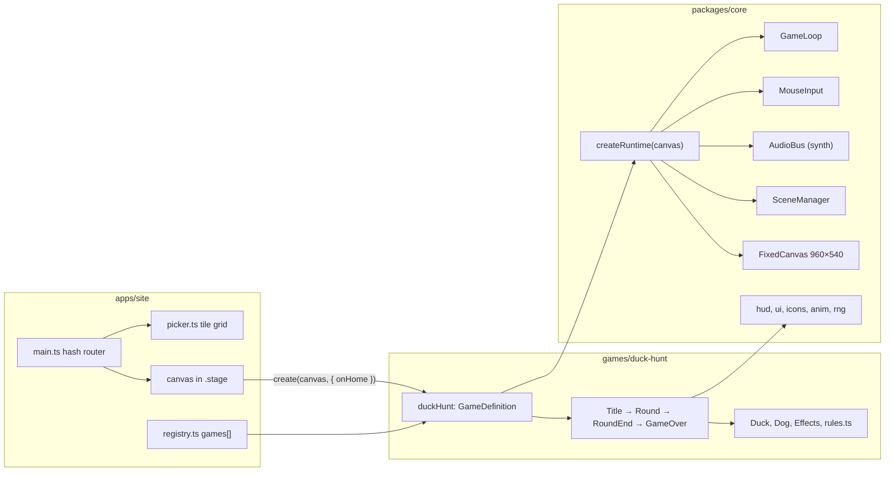

# Game Factory Architecture

The repo is an npm-workspaces monorepo. Three kinds of packages exist: one shared engine, any number of games, and one site that hosts them. Games never import each other and never touch the DOM outside their canvas. The site owns routing and the canvas element; the engine owns everything that happens inside the canvas.



## Contract between site and game

A game is a plain object:

```ts
interface GameDefinition {
  id: string
  title: string
  icon: string
  create(canvas: HTMLCanvasElement, opts: { onHome(): void }): { destroy(): void }
}
```

The site calls `create` when the route `#/play/<id>` becomes active and calls `destroy` when the route changes. The game calls `opts.onHome()` when the player presses a home button. Nothing else crosses the boundary.

## What the engine gives a game

`createRuntime(canvas)` returns one object with everything wired:

- **FixedCanvas**: logical 960×540 surface, letterboxed to the parent element, hidden system cursor. All game code works in logical pixels.
- **GameLoop**: requestAnimationFrame loop with a clamped delta time. It pauses on window blur or tab hide and draws a pause overlay. The first click resumes.
- **MouseInput**: pointer position in logical pixels plus click callbacks.
- **AudioBus**: name → builder map. Sounds are synthesized with Web Audio oscillators and filtered noise, so there are no audio files and no licences to track. The AudioContext is created on the first click to satisfy autoplay rules.
- **SceneManager**: holds one active scene. A scene implements `update(dt)`, `draw(ctx)` and optionally `enter`, `exit`, `onClick`.
- Drawing helpers: `drawText`, `drawPanel`, `drawIconRow`, icon drawers, `createKidButton` (circular, 96 px minimum, hover scale, selected ring).

## Kid UX rules baked in

- No reading needed to play. Buttons are icon-only. Text is numbers or decorative titles.
- Every click produces a sound.
- Buttons are at least 96 px and placed away from screen edges.
- One screen, no scrolling, no menus deeper than one level.

## Duck Hunt specifics

Rules live in `games/duck-hunt/src/rules.ts` as pure functions and tables so they can be tuned without touching scenes. Difficulty changes shots per duck, pass line, duck size, speed and flight time. Speed also grows 10 % per round up to round 10. Head hits score 300, body hits 100, a perfect round adds 1000.

The round scene is a small state machine: intro (dog walks and jumps into grass), duck (flying, player shoots), hit or escape (duck falls or flies off), react (dog holds the duck or laughs), then the next duck or the round-end scene.
