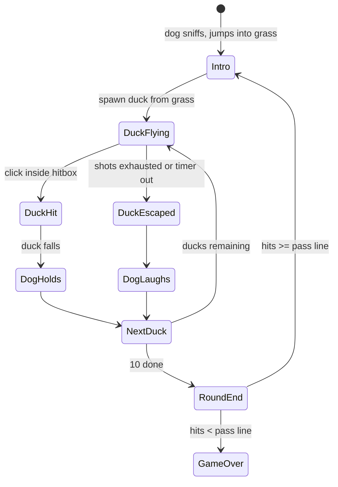

# Kids Game Factory — Game 1: Duck Hunt

## Context

Goal: a site that hosts many small browser games for young kids (first player: a 4-year-old), no ads, no accounts, no backend. Duck Hunt is game 1 and also the forcing function for the shared engine every later game reuses.

Decisions made with the user (2026-10-05):

| Topic | Decision |
|---|---|
| Platform | Web, desktop only (mouse). Touch deferred. |
| Tone | Classic Duck Hunt feel: gun crosshair, bang, duck drops, dog. |
| Repo shape | Monorepo: `packages/core` + `games/duck-hunt` + `apps/site`. |
| Stack | TypeScript + Vite + Canvas 2D. No game engine, no physics lib. |
| v1 scope | Core loop, easy/normal difficulty, head-shot bonus. High score + mute deferred. |
| Assets | Original hand-drawn/generated sprites + CC0 sounds. No Nintendo assets. |
| Verification | Manual browser check by user. Agent never runs lint/build/tests. |

Package manager: **npm workspaces** (Node 24 present, pnpm not installed; avoids extra install).

## Findings

Research on original NES Duck Hunt (sources: [Wikipedia](https://en.wikipedia.org/wiki/Duck_Hunt), [nindb Game A guide](https://nindb.net/guides/duck-hunt/game-a.html), [GameFAQs overview](https://gamefaqs.gamespot.com/nes/587252-duck-hunt/faqs/67372/game-overview)):

- 10 ducks per round, one at a time (Game A). 3 shots per duck.
- Pass line: 6 of 10 in rounds 1–10, rising to 10 of 10 by round 20+.
- Points by duck colour, not hit location: black 500 / blue 1000 / red 1500, scaled up every 5 rounds. **Head-shot bonus does not exist in the original**; it is our addition.
- Perfect round bonus 10 000+.
- Miss all 3 shots: duck flies off, dog laughs. Hit: dog pops up holding duck.
- Speed rises every 5 rounds.

Reference clones for structure ideas (not for assets): [monsieurplus/duckhunt](https://github.com/monsieurplus/duckhunt), [Adi52/duck-hunt](https://github.com/Adi52/duck-hunt), [MattSurabian/DuckHunt-JS](https://github.com/MattSurabian/DuckHunt-JS).

Kid UX guidance ([NN/G](https://www.nngroup.com/articles/children-ux-physical-development/), [Smashing](https://www.smashingmagazine.com/2024/02/practical-guide-design-children/)): no reading required, audio + icon feedback on every action, targets ≥75 px, single-step interactions, keep controls away from screen edges.

## Architecture

```mermaid
flowchart LR
  subgraph apps/site
    Shell[Vite app: game picker + /play/:id route]
  end
  subgraph games/duck-hunt
    DH[createDuckHunt(canvas, opts) → GameHandle]
  end
  subgraph packages/core
    Loop[GameLoop] --> SceneMgr[SceneManager]
    SceneMgr --> Input[MouseInput]
    SceneMgr --> Audio[AudioBus]
    SceneMgr --> Sprites[SpriteSheet / Assets]
    SceneMgr --> Hud[Hud + KidButton]
    Canvas[FixedCanvas 16:9 scaler]
  end
  Shell -->|registry entry| DH
  DH --> Loop
  DH --> Canvas
```

Game registry contract (what every future game implements):

```ts
export interface GameDefinition {
  id: string
  title: string
  icon: string
  create(canvas: HTMLCanvasElement, opts: GameOptions): GameHandle
}
export interface GameHandle { destroy(): void }
```

Site shell holds `games: GameDefinition[]`. Adding game 2 = new folder + one registry line.

## Repo layout

```
shooting-bird/
  package.json              workspaces: packages/*, games/*, apps/*
  tsconfig.base.json
  packages/core/
    src/
      loop.ts               requestAnimationFrame loop, fixed dt, pause on blur
      canvas.ts             fixed 960x540 logical canvas, letterbox scale to window
      input.ts              mouse position + click events in logical coords
      audio.ts              AudioBus: load, play, master mute flag (toggle UI deferred)
      assets.ts             image/sound preloader with progress
      sprite.ts             SpriteSheet + Animation (frame index by time)
      scene.ts              Scene interface {enter, update, draw, exit}, SceneManager
      hud.ts                score text, round text, shot/duck icons
      ui.ts                 KidButton: ≥96px, icon-only, hover/press states
      rng.ts                seeded random helpers
      game.ts               GameDefinition / GameHandle / GameOptions types
      index.ts
  games/duck-hunt/
    src/
      index.ts              exports duckHunt: GameDefinition
      rules.ts              pure: difficulty table, scoring, pass line, speed curve
      duck.ts               Duck entity: flight path, hitbox (body + head), states
      dog.ts                Dog entity: intro sniff, laugh, hold-duck
      scenes/
        title.ts            play button, easy/normal toggle icons
        round.ts            main gameplay
        roundEnd.ts         tally, pass/fail, dog reaction, perfect bonus
        gameOver.ts         score, big replay button
    assets/
      sprites/              duck.png, dog.png, scenery.png, crosshair.png (own art)
      sounds/               shot, quack, flap, fall, dog-laugh, win, lose (CC0)
  apps/site/
    index.html
    src/
      main.ts               router: / picker, /play/:id mounts game
      registry.ts           games array
      picker.ts             grid of GameDefinition icons, big tiles
```

## Duck Hunt v1 rules (`rules.ts`, pure functions, no DOM)

| Rule | Normal | Easy |
|---|---|---|
| Ducks per round | 10 | 10 |
| Shots per duck | 3 | 5 |
| Pass line | 6 | 4 |
| Duck scale | 1.0 | 1.5 |
| Speed multiplier | 1.0 | 0.6 |
| Flight time before escape | ~6 s | ~8 s |

- Points: body 100, head 300 with sparkle burst. Perfect round +1000.
- Speed +10 % per round, capped at round 10.
- Hitbox: duck sprite bounds + 20 % padding; head sub-box is top-front third. Head check first, then body.
- Game over when round fails. Game over screen = score + big replay button + home button.

### Round state machine



## Kid UX constraints (enforced in core)

- Zero text needed to play. Title screen: play icon, duck-size icons for easy/normal. Numbers only in HUD.
- Audio cue on every click, hit, miss, round end.
- Buttons ≥96 px, placed inward from edges.
- Fixed 16:9 logical canvas, letterboxed, no page scroll, `cursor: none` over canvas with drawn crosshair.
- Auto-pause on tab blur, resume on click.

## Implementation steps

1. **Workspace scaffold**: root `package.json` (workspaces, scripts `dev`, `build`), `tsconfig.base.json`, three package manifests, Vite config in `apps/site` aliasing workspace packages.
2. **core**: `canvas.ts`, `loop.ts`, `input.ts`, `scene.ts` first (enough to draw a moving box). Then `assets.ts`, `sprite.ts`, `audio.ts`, `hud.ts`, `ui.ts`, `game.ts`.
3. **Assets**: draw simple pixel sprites (SVG or PNG via script) for duck (fly 3 frames × 3 directions, hit, fall), dog (sniff, jump, laugh, hold), scenery (sky, tree, grass), crosshair. Pull CC0 sounds from freesound/Kenney; record licence in `games/duck-hunt/assets/LICENSES.md`.
4. **duck-hunt rules.ts**: difficulty table, scoring, pass line, speed curve.
5. **duck-hunt entities**: `duck.ts` (flight = sine-wave zigzag with random turns, bounded to sky area), `dog.ts`.
6. **duck-hunt scenes**: title → round → roundEnd → gameOver. Wire via `SceneManager`.
7. **duck-hunt index.ts**: `GameDefinition` export.
8. **site**: registry, picker grid, `/play/duck-hunt` mount + destroy on navigate.
9. **ai/docs**: short architecture note on how to add game 2 (one mermaid diagram). Written after code works.

Code style per user rules: no explanatory comments, Conventional Commits if user asks for commits, no attribution trailers.

## Status (2026-10-05)

Implementation steps 1–9 written and verified in browser on 2026-10-05. Typecheck clean, no console errors.

Verified: picker, title, easy and normal rounds, body hit (+100), head hit (+300, sparkles), timed-out escape, shots-exhausted escape, dog hold/laugh/cheer, round pass to round 2, round fail to game over, home button, pause on blur with click to resume, no page scroll.

Not verified: sound (not observable from the browser tool), replay button, perfect-round bonus, canvas resize behaviour.

Fixes made during verification: null narrowing in `apps/site/src/main.ts`, larger difficulty icons, dog raised above grass, landed duck hidden under dog.

## Verification pass (agent runs — one-time exception granted by user 2026-10-05, this project only)

1. `npm install` at repo root.
2. `npm run typecheck`; fix every TypeScript error in place, no scope creep.
3. Create `.claude/launch.json` with one config (`npm run dev`, port 5173) and start it via the built-in browser preview.
4. Open `http://localhost:5173`, read console for errors, walk the checklist below in the built-in browser: picker, title, easy and normal rounds, body hit, head hit, misses, round end, game over, home.
5. Fix defects found, re-check the affected item.
6. Stop the dev server. Report what passed, what failed, what could not be checked (sound is not observable from the browser tool; pause-on-blur may need the user).

No commits, no push. No lint.

Checklist:

- [ ] Site loads, one tile "Duck Hunt", click opens game, no scroll bars, canvas letterboxes on resize.
- [ ] Title: click easy icon then play; duck visibly bigger and slower than normal.
- [ ] Round: duck spawns from grass, flies within sky bounds, crosshair follows mouse, click plays shot sound, HUD shot count drops.
- [ ] Body hit: duck falls, dog holds it, +100. Head hit: sparkle, +300.
- [ ] 3 misses (normal) / 5 (easy): duck escapes, dog laughs.
- [ ] 10 ducks → tally; ≥ pass line → next round faster; < pass line → game over with replay + home.
- [ ] Perfect round shows bonus.
- [ ] Switch browser tab mid-duck: game pauses; click resumes.
- [ ] Home button returns to picker, game audio stops.

## Hosting (2026-10-10)

Source: github.com/KhizerRehan/ai, folder `games/shooting-bird`. Deploy: `.github/workflows/deploy-shooting-bird.yml` builds with base `/ai/` and publishes to GitHub Pages on every push touching this folder. Live URL: https://khizerrehan.github.io/ai/. Pages source must be set to "GitHub Actions" in repo settings. A private copy also exists as a Claude artifact.

## Deferred (not v1)

Touch input, high score persistence, mute button UI, multiple ducks at once, duck colours with different points, leaderboard, PWA/offline.
